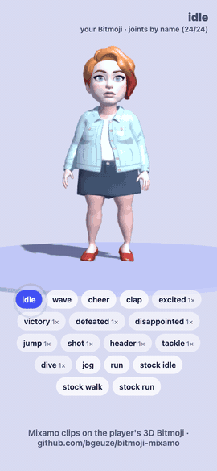

# bitmoji-mixamo

Mixamo animations on the player's 3D Bitmoji, in a Snapchat Web Lens built with PlayCanvas.



`snapchat.bitmoji.get3DAvatar()` gives you the player's Bitmoji as a rigged GLB **with no animations**. This kit gets your Mixamo clips onto it:

1. **Convert.** Drop Mixamo FBX files into the [converter](https://bgeuze.github.io/bitmoji-mixamo/converter/). You get one small `animations.glb`. The page runs entirely in your browser.
2. **Play.** Copy `bitmoji-anim.js` into your lens (its only dependency is `playcanvas`):

```js
import { loadBitmoji } from './bitmoji-anim.js';

const bitmoji = await loadBitmoji(app, {
  clips: './animations.glb',
  fallback: './avatar_default.glb',   // for players without a Bitmoji, and the desktop stub
});
app.root.addChild(bitmoji.entity);
bitmoji.play('dance');
```

That's all. `bitmoji-anim.js` takes care of the rest:

- **Snap's fallback rules**: no capability, no Bitmoji, the desktop stub, `ERR_INTERNAL`, a GLB that fails to load, or a URL that never comes. Snapchat builds the avatar on the phone, which can take a while, so the URL gets 15 s and the GLB 30 s before your fallback takes over.
- **The GLB's traps.** It puts the model under its own pivot, because transforming the GLB's root lays the figure on its side. It turns culling off on the skinned meshes, whose bounds land metres off. It hides the mouth mesh, which sits below the chin without a face rig. It registers the GLB loaders when a bare `AppBase` lacks them.
- **Crossfades between clips**, from whatever pose is on screen, plus one-shots you can `await`.

▶ [Full demo video (MP4)](media/demo.mp4): the demo lens with 17 Mixamo clips converted with this kit, tapping through nine of them on a test Bitmoji.

<br clear="right">

## Getting clips from Mixamo

- **Best:** upload Snap's `UploadToMixamo.fbx` ([Snap's "Animating Bitmoji 3D" guide](https://developers.snap.com/lens-studio/features/bitmoji-avatar/animating-bitmoji-3d)) to [mixamo.com](https://www.mixamo.com) and pick your animations on it. Clips made on Snap's rig fit the Bitmoji's proportions best.
- **Also works:** clips downloaded on Mixamo's stock characters (Y Bot, X Bot, …); `bitmoji-anim.js` retargets them onto the Bitmoji. Their legs and arms are longer than a Bitmoji's, so feet can slide a little in big moves.
- **Download settings:** FBX Binary, **Without Skin** (smaller; the skin is ignored anyway), 30 fps.
- Tick **In Place** for walks and runs when your game moves the character itself.

## The API

```ts
loadBitmoji(app, {
  clips?: string | ArrayBuffer | (string | ArrayBuffer)[],  // converter output(s)
  fallback?: string,       // your own character on Snap's rig
  url?: string | null,     // load this GLB instead of asking Snapchat (testing); null = fallback
  snapchat?: object,       // the Web Lens API; defaults to window.snapchat
  hideMouth?: boolean,     // default true
  autoUpdate?: boolean,    // default true: advances on app 'update'; false = call update(dt)
  timeout?: number,        // GLB load timeout, ms (default 30000)
}) → Promise<Bitmoji>

bitmoji.entity            // add to your scene; move, turn, scale this
bitmoji.isReal            // true = the player's own Bitmoji (or your url), false = your fallback
bitmoji.mode, .found      // 'name' | 'shape' ('none' without clips): how its joints were found, and how many of 24
bitmoji.clips             // ['idle', 'dance', …]; bitmoji.isLoop(name), bitmoji.length(name)
bitmoji.play(name, { fade = 0.2, loop, speed = 1, from })
                          // → Promise<boolean>: true when a one-shot plays to its end, false when cut off
bitmoji.stop()            // hold the pose; the next play() fades from it
bitmoji.joint('RightHand')    // attach a prop to a joint
bitmoji.destroy()
```

```js
// A one-shot, then back to the loop (unless something else was played over it):
if (await bitmoji.play('wave', { loop: false })) bitmoji.play('idle', { fade: 0.4 });
```

`loadBitmoji` rejects when neither the Bitmoji nor your fallback loads, and when a clips file cannot be read: that is a bug in the lens, so it is reported as one rather than covered by the fallback.

Types are in `bitmoji-anim.d.ts`.

## The default avatar

Snap's guidelines ask for a default character on the same rig, for players without a Bitmoji and for the desktop stub, whose 3D avatar is an empty placeholder. Snap's docs mention an `avatar_default.glb` in their `bitmoji-dance` example, but that example is not public at the time of writing. So bring your own character on Snap's rig and pass it as `fallback`. One way to get one: import Snap's `UploadToMixamo.fbx` into Blender (File › Import › FBX), then File › Export › glTF 2.0. Check the licence that comes with it before you ship it.

Without a fallback, players who have no Bitmoji get no character at all (`loadBitmoji` rejects).

## Command line

```bash
npm install                      # three.js, for the FBX reader
node cli.mjs idle.fbx dance.fbx wave.fbx -o animations.glb --fps 30 --once wave
```

## Demo lens

`demo/` is a minimal Web Lens: the player's Bitmoji and a button for each clip. It ships with two hand-made sample clips (`idle`, `wave`). Put your converter output in `demo/public/animations.glb` and every clip in it gets a button too: loops keep playing, one-shots (1×) return to idle when they end. The status line shows whether the joints were found by name or by shape, which is worth a screenshot when you test on a phone.

The demo ships without a default avatar (see above): in Snapchat it shows your Bitmoji, and anywhere else it needs `demo/public/avatar_default.glb` or `?bitmoji=./some.glb`.

```bash
cd demo && npm install && npm run dev        # desktop: needs a GLB on Snap's rig, see above
npm run zip                                  # demo.zip, ready for My Lenses (~540 KB + your clips)
```

Open `?bitmoji=./some.glb` to test with any GLB on Snap's rig.

## How it works

The Bitmoji rig names its joints the way Mixamo does (`Hips`, `Spine`, `LeftArm`, …) plus Snap's helpers (`C_spine0002_bind_JNT`, …). The two rigs still differ in three ways:
- Mixamo only exports FBX.
- Stock Mixamo bones are prefixed `mixamorig:`.
- The Bitmoji's Hips sit under a root that is scaled by 0.01 and turned 90°.

The converter (three.js FBX reader, browser or Node):
- matches each joint by name;
- each frame, stores every joint's **turn away from the source's T-pose**, in character space (Y up, facing +Z). A turn in space says nothing about any skeleton's bone axes, so the clip holds no data about the rig it will play on;
- stores the source's T-pose (joint positions) and the Hips' position, both in units of hip height.

Mixamo hands every character back in the same T-pose, so clips made on Snap's rig and on Y Bot are read the same way.

`bitmoji-anim.js` does not count on the avatar's joint names. The Bitmoji that Snapchat builds on the phone need not name its joints the way the published rig does. So the player finds the joints by name, or else by the shape of the skeleton:
- the toes are the lowest bones;
- the hips are where the legs and the spine meet;
- the arms are the chains out to the bones furthest to each side.

Then each bone takes the clip's turn, starting from its own rest pose swung to point the way the source's bone pointed in the T-pose. Joint names, bone axes, rest pose (A or T), units and the GLB's root transform can all differ. What it does count on: the model stands upright (Y up) on its own origin, as Snap's Bitmoji GLB does.

The output is plain glTF 2.0 (it passes the Khronos glTF validator): one node per joint, one animation per clip, rotations as normalized int16. That comes to about 6 KB per second of animation at 30 fps plus about 8 KB per clip; 15 fps makes it about 40% smaller.

Checked numerically against an independent Blender pipeline on Snap's rig (`scripts/check.mjs`):
- **joints found by name:** 0.3 cm per joint on average;
- **every node renamed, joints found by shape:** 0.6 cm on average, at most about 5 cm (the head's pivot).

## Licence

MIT, by [Baruch Geuze](https://baruchgeuze.nl/weblens). Mixamo animations are subject to Adobe's Mixamo terms, and Bitmoji to Snap's. This repository ships neither, nor any data taken from Snap's rig: the demo's two clips are hand-made.
